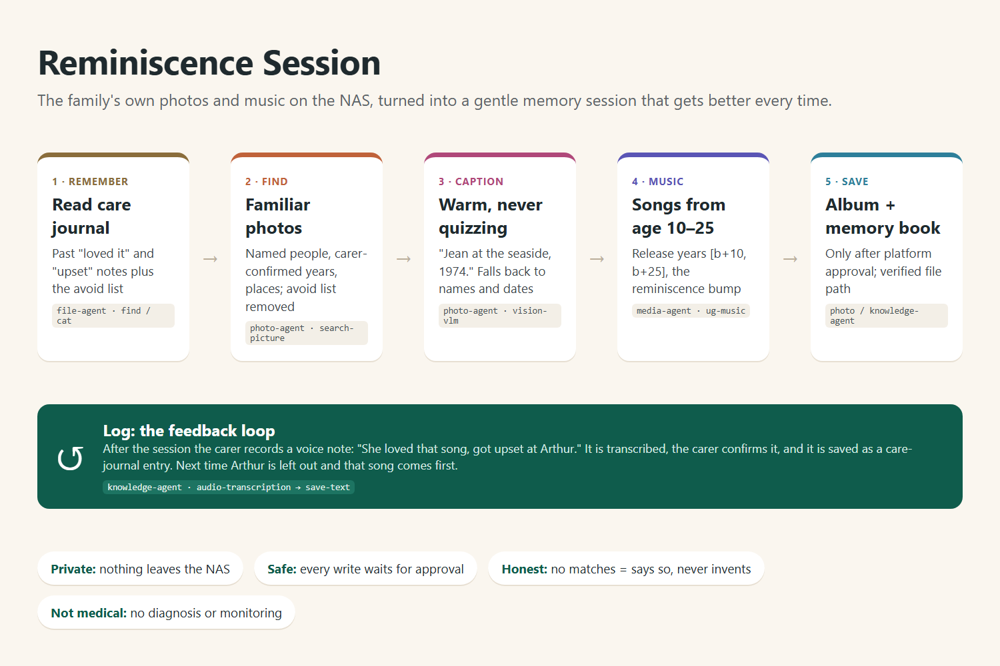

# Reminiscence Session

**A UGOS Skill for UGREEN AI NAS that turns a family's own photos and music into gentle reminiscence sessions for a loved one living with dementia, and learns from each session what brings joy or distress.**

UGREEN Hackathon 2026 on AI NAS · Track: **Bring Memories to Life** · Round 1 (Pre-test Skill Package)


## Why

In an elder care home, I watched a quiet resident with Alzheimer's light up and sing along to an old song from her youth. Reminiscence with familiar photos and music is one of the gentlest activities in dementia care. But family carers are exhausted, and preparing a session means digging through decades of photos, matching songs to the right era, and remembering what upset the person last time. Everything a session needs is already on the family NAS. This Skill lets the NAS do the remembering.

## What it does



| Mode | What happens |
|---|---|
| **Prepare** | Reads past care-journal notes and the avoid list, then finds photos of the chosen people, years or place. It writes short, dignity-safe captions that never quiz or correct, picks songs from the person's teens and twenties, creates an album after platform approval, and saves a printable memory book. |
| **Play** | Plays the session's songs, only when the carer asks. |
| **Log** | Transcribes the carer's voice note after the session. Once the carer confirms it, it saves a care-journal entry, so the next session puts favourites first and leaves out what caused distress. |

Music window, the "reminiscence bump": for birth year *b*, songs come from release years *b + 10* to *b + 25*.

## NAS capabilities used

| Expert | CLI actions |
|---|---|
| `file-agent` | `ug-filesystem` `find`, `cat`: read the care journal |
| `photo-agent` | `ug-photo` `figure-albums`, `search-picture`, `vision-vlm`, `create-album` |
| `media-agent` | `ug-music` `search` (type `year`), `control` |
| `knowledge-agent` | `ug-knowledge` `audio-transcription`, `save-text` |

The Skill is a pure orchestration `SKILL.md` that follows the **Uliya Skill Development Standard**. The parent only delegates self-contained instructions to registered experts. Later steps use only verified results from earlier ones. Every write waits for platform approval, and all five delegation states are handled: `completed`, `failed`, `cancelled`, `waiting_user` and `waiting_approval`. Empty results are reported as empty, never widened or invented. No data leaves the NAS.

## Repository layout

| Path | Contents |
|---|---|
| [`skill/reminiscence-session/`](skill/reminiscence-session/) | **The Skill**: [`SKILL.md`](skill/reminiscence-session/SKILL.md) plus `references/` (README, configuration template, session design rules, care-journal format, test plan, disclosures) |
| [`submission/`](submission/) | The files uploaded to Devpost: `reminiscence-session.zip` (Skill package) and `proposal.pdf` (project proposal) |
| [`proposal/`](proposal/) | HTML source for the proposal PDF and the workflow diagram |
| [`context/`](context/) | Project notes: story, submission-form text, kit findings, decision log, images |

## Validation status

- ✅ Passes the static checker from UGREEN's Skill Developer Package (`static-pass`, 0 errors, 0 warnings, catalog 2.2.0).
- ✅ Package limits: 7 Markdown files, about 12 KB zipped; no scripts, binaries or credentials.
- ⏳ **Not yet run on a real NAS.** Round 1 doesn't require it. The points to test on a NAS, such as `vision-vlm` on searched photo paths, music result fields and the approval flow, are listed in the [test plan](skill/reminiscence-session/references/test-plan.md).

To re-run the static check, download the Skill Developer Package from UGREEN's [hackathon starter kit page](https://ai.ugreen.com/pages/hackathon-starter-kit) (it isn't redistributed here), then run:

```
node uliya-skill-kit/scripts/check-skill.mjs skill/reminiscence-session
```

## Safety and scope

It does not diagnose, give medical advice, or monitor anyone. Caption rules forbid quizzing or correcting the person, and an avoid list always overrides relevance. All testing uses **synthetic data only**.

## Disclosures

- **Third-party code, libraries, models and media bundled in the Skill:** none (Markdown only).
- **Platform:** UGREEN Uliya Skill Development Standard and UGOS Skill Creation Tool (uliya-skill-kit 0.7.7).
- **AI tools:** Claude Code (Anthropic) helped read the kit, draft the Skill, documents and proposal, and run the checker. Runware (FLUX.1 dev) generated the hero image. See [`disclosures.md`](skill/reminiscence-session/references/disclosures.md).
